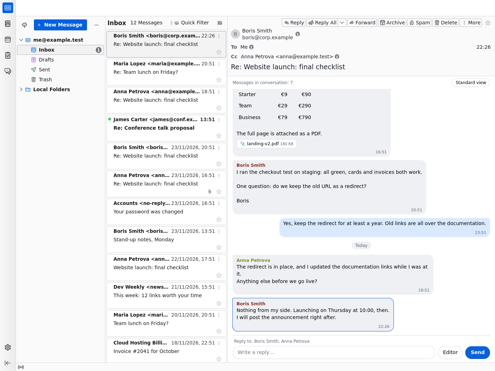

# Chat View for Thunderbird

Shows an e-mail conversation as a chat inside the message pane: bubbles (yours
on the right), quoted text and signatures removed, new messages appear by
themselves, quick reply at the bottom.

Uses only Thunderbird's standard add-on APIs: no Experiment APIs, so no "full
access" permission and nothing tied to Thunderbird internals.

## How it works

- A message display script asks the background page for the conversation of
  the displayed message. A single message is left exactly as Thunderbird shows
  it; two or more become a chat. "Standard view" in the top bar switches back,
  "Open in standard view" on a bubble opens that message in a tab. Messages in
  their own tab or window are always shown the standard way.
- A conversation is: same subject (reply/forward prefixes and gateway tags such
  as `[EXT]` ignored) and the same correspondents, plus whatever the displayed
  message's `References` name. Other messages' headers are not read: on IMAP
  that would download each of them. Searched: the message's folder plus Inbox,
  Sent and Archives of the account, two months either side, then about a year
  back if the conversation reaches the edge of that. "Search for older
  messages" looks through every folder of the account.
- HTML mail is shown as HTML, each in a shadow root of its own, after scripts,
  frames, forms, event handlers and non-http links are removed. Pictures inside
  the mail are shown; remote ones follow Thunderbird's remote-content setting.
  The quote of the previous message and the signature are cut from the end.
- Bodies are loaded only for the messages on screen.
- New mail, moves, deletions and sent replies update the open chat through
  Thunderbird's events.
- A quick reply is a normal reply-all to the newest message, sent through
  Thunderbird's own compose window (it opens for a moment). It carries the
  typed text and the signature only; the quoted message is taken out ("Editor"
  opens a normal reply with the quote). It is sent from the account the conversation is in
  (the address last written from or to); the "From" box changes that.
- Collapsed threads: for a collapsed thread Thunderbird shows its own summary
  page, which an add-on cannot change. Best is to set
  `mail.operate_on_msgs_in_collapsed_threads` to `false` (Settings > General >
  Config Editor): a click then displays the thread's first message, the chat
  shows the whole conversation and the thread stays collapsed. The price:
  Delete and Archive on a collapsed thread act on its first message only.
  Without that setting the add-on selects the thread's first message itself,
  which expands the thread and waits for Thunderbird's summary first (option
  in the add-on's settings, as is marking the shown messages as read).

## Build, install, test

    ./build.sh                       # -> dist/tb-chat-<version>.xpi

Install: Add-ons Manager → gear → Install Add-on From File. Needs Thunderbird 153 or newer (tested on 153 ESR, 158 and 161).

    node --test test/text.test.mjs   # quote stripping
    test/start.sh /tmp/tbw           # headless Thunderbird on a throw-away profile,
    python3 test/all.py /tmp/tbw     #   fake POP3/SMTP on localhost, end-to-end checks
    test/stop.sh /tmp/tbw

## Known limits

- Thunderbird's message search walks whole folders and blocks the window while
  it does: unnoticeable for a few thousand messages, about 0.3 s on the first
  click in a 30,000-message folder.
- Without access to Thunderbird's thread data, two separate conversations with
  the same person under the same subject are shown as one.
- At most 400 messages of a conversation are shown (the latest ones).

## License

Copyright (C) 2026 tedvask

This program is free software: you can redistribute it and/or modify it under
the terms of the GNU General Public License as published by the Free Software
Foundation, either version 3 of the License, or (at your option) any later
version.

This program is distributed in the hope that it will be useful, but WITHOUT ANY
WARRANTY; without even the implied warranty of MERCHANTABILITY or FITNESS FOR A
PARTICULAR PURPOSE. See the GNU General Public License in [LICENSE](LICENSE)
for more details.

SPDX-License-Identifier: GPL-3.0-or-later
